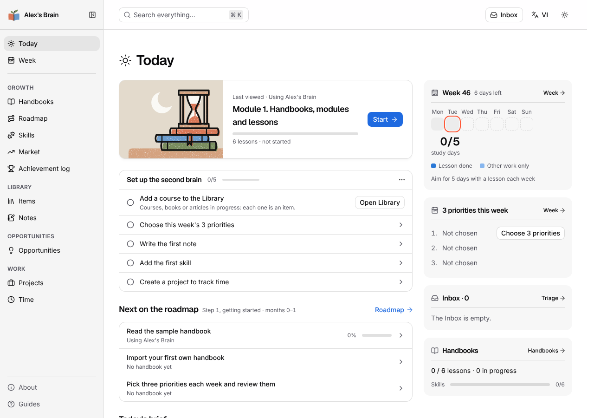
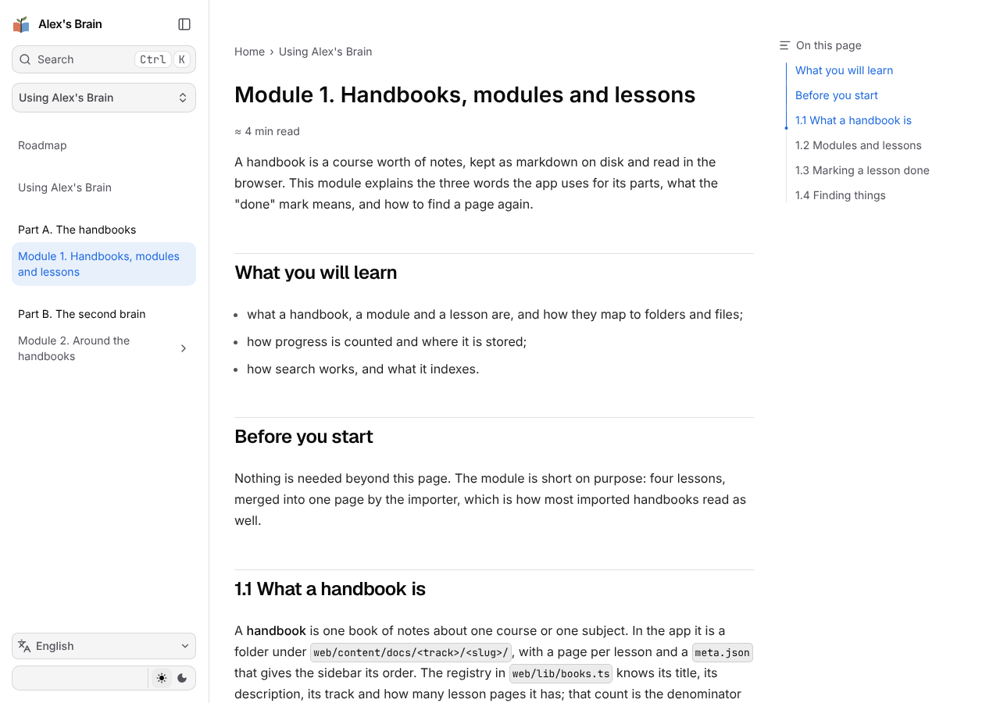

# Alex's Brain

> **Tiếng Việt.** Alex's Brain là một trang học tập tự host từ các sổ tay ghi chú khóa học (markdown), kèm một "bộ não
> thứ hai": inbox, kế hoạch và nhìn lại tuần, thư viện và ghi chú, cơ hội kinh doanh có bằng chứng, kỹ năng tự mờ theo
> thời gian, bản tin sáng. Giao diện có hai ngôn ngữ (tiếng Việt mặc định, tiếng Anh). Bản công khai này không kèm sổ
> tay của tác giả; nó có một sổ tay mẫu và hướng dẫn nhập sổ tay của bạn bên dưới.

A self-hosted study site built from your own course notes ("handbooks" of markdown), plus a second brain around it:
an inbox, a weekly plan and review, a library of items and notes, business opportunities backed by evidence, skills
that fade without fresh evidence, and a morning news brief. Single owner, behind a login, the data is yours (export
as markdown and JSON at any time). Next.js + Fumadocs for the site, Django + Postgres for the data.

The author built it for 15 handbooks of Vietnamese notes from Coursera and F8 courses (about 18,800 source pages
merged into 4,750 lessons). Those handbooks are not part of this repository; it ships with one small sample handbook
about the app itself, and an importer for your own material.





## What it does

* **Handbooks**: markdown on disk, compiled on request and cached (the build time does not grow with the page count),
  full-text search (SQLite FTS5) over every heading section, a "done" mark per lesson, a lazy sidebar per book, a
  roadmap page (`web/content/roadmap.json`).
* **Second brain** (with the backend): Inbox with keyboard triage and AI tags, Items and markdown notes (a block
  editor with `[[ ]]` links and autosave), List and Board views, a Week with objectives and a 15-minute review,
  projects with a timer and the effective hourly rate, opportunities with evidence and score history, skills with
  evidence that fades after 3 and 6 months, a job-ad market report, an achievement log, predictions re-scored after
  6 months, a morning brief from RSS feeds, Cmd+K over everything, a bookmarklet and a PWA share target.
* **Two UI languages**: Vietnamese (default) and English, switched with a cookie on the same URLs.

## Quick start: the web app only

Requirements: Node 22 or newer (the search index uses `node:sqlite`), macOS or Linux.

```bash
git clone <this repository> alex-brain
cd alex-brain/web
npm ci
npm run search:rebuild
npm run dev
```

Open http://localhost:3000. You get the study site with the sample handbook, search and progress stored in the
browser. The second-brain pages need the backend: without it they show an error state with "Thử lại" (retry).

For a production server of the web app alone:

```bash
npm run build
npm start
```

`npm start` serves on `PORT` (default 3000) and reads `CONTENT_DIR` (default `web/content/docs`) and `SEARCH_DB`
(default `web/data/search.sqlite`).

## Quick start: with the backend

Requirements as above, plus Python 3.13 with [uv](https://docs.astral.sh/uv/), Postgres 16 and `lsof`.

```bash
# Postgres: a local server, or the container in backend/docker-compose.yml
docker compose -f backend/docker-compose.yml up -d        # or create role and database alex_brain yourself

cp backend/.env.example backend/.env                       # then set SECRET_KEY (any long random string)
cd backend && uv sync && cd ..
cd web && npm ci && npm run search:rebuild && cd ..
make dev
```

`make dev` builds the web app with the API progress store, runs the migrations and starts Django (:8000), the Next
production server (:3100), a small proxy that routes like nginx (:8080) and the background jobs loop. Open
http://localhost:8080. `AUTH_MODE=dev` in `backend/.env` trusts one local user without a login (it is refused unless
`DEBUG=true`). Optional: `cd backend && uv run python manage.py brief_sources seed` adds the default news feeds.

## Add a handbook

```bash
node web/scripts/import-gitbook.mjs <export.zip | handbook.html | folder> --track <kinh-doanh|it|ky-nang> \
  --slug <ascii-slug> --title "<title>" [--description "..."] [--merge auto|m2|module|m1|none] [--cover <name>]
```

Three inputs, picked from the path (or `--from zip|html|markdown-dir`):

* **GitBook zip**: a markdown export with `SUMMARY.md` and one file per page;
* **single HTML**: a handbook in one HTML file with an embedded `<script id="book-data">` JSON block;
* **folder of markdown**: with a `SUMMARY.md` it is read like the zip; without one, each sub-folder is a module,
  each `.md` file a lesson, in natural name order (`2-x` before `10-x`), a folder's `README.md` or `index.md` is
  its page and titles come from each file's first `# heading` (else its name).

One command: merges items into learning pages (structure only, the text is never rewritten), normalizes GitBook
syntax, writes `web/content/docs/<track>/<slug>/`, registers the book in `web/lib/books.ts` and re-indexes search.
Try it on the sample: `node web/scripts/import-gitbook.mjs web/examples/sample-handbook --track it --slug my-test
--title "My test"` (remove it again with `rm -r web/content/docs/it/my-test` and its entry in `web/lib/books.ts`).

The merge modes (`--merge`, `auto` picks one): `m2` makes one page per lesson group when module introductions list
their lessons under bold group labels; `module` makes one page per module, split into parts above 12 lessons or
about 120 KB; `m1` folds near-empty pages into the previous page; `none` keeps one page per file. Every merged item
keeps its own heading and anchor, so links between pages still land.

Then:

1. add its English title and description to `web/lib/i18n/en/shell.ts` (the coverage test asks for them),
2. restart `npm run dev`, or rebuild for production (the registry is code),
3. optional: list the slug before `"..."` in `web/content/docs/<track>/meta.json` (`pages`) to set its position;
   add its programs to `web/content/courses.json` and run `node web/scripts/extract-courses.mjs` (the card's "Links"
   menu); `node web/scripts/prepare-assets.mjs <slug> <folder>` if it links attachments (`/files/...`).

Check with `node web/scripts/smoke-test.mjs --book <slug>` while a server runs. Images with external URLs render as
placeholders (no request leaves the site); `web/scripts/backfill-images.mjs` downloads them into `web/public/img/` when
you have working URLs.

## Where the data lives

| What | Where |
| --- | --- |
| Handbooks | `web/content/docs/<track>/<slug>/` (markdown + `meta.json`), the registry in `web/lib/books.ts` |
| Roadmap | `web/content/roadmap.json` (sample shipped; delete it and the page and its sidebar row go away) |
| Search index | `web/data/search.sqlite` (gitignored, `npm run search:rebuild`) |
| Progress | the browser's localStorage (web only) or Postgres (with the backend, `NEXT_PUBLIC_PROGRESS_STORE=api`) |
| Everything else | Postgres; item pictures and inbox thumbnails as webp files in `THUMBS_DIR` |
| Export | `GET /api/export` ("Download a copy of my data" on the Handbooks page) or `manage.py export --out <dir>`: notes as markdown with front matter, every other table as JSON, the pictures |
| Backups | `make backup` (`pg_dump` + the pictures) and `make restore-check` (restores into a throwaway database) |

## AI features and their cost

AI runs only in background jobs (`manage.py run_jobs`, every 5 minutes by cron or `make jobs`), never inside a
request: inbox tags and summaries, skills from pasted job ads, news tags and the brief's intro. Bring your own key:

* `LLM_PROVIDER=gemini` with `GEMINI_API_KEY` (the free tier works; `LLM_FREE_TIER=true` records cost 0). An
  `anthropic` provider is planned (`backend/core/services/llm.py` is the one place that calls an LLM).
* **Budget guard**: `LLM_MONTHLY_BUDGET_USD` (default 5) is a hard cap. Every call is counted in tokens before it is
  sent and priced at paid-tier rates even on a free tier; a call that would pass the month's cap is refused and the
  job waits. Every call is logged (`LlmCall`), results are cached by content hash, and `GET /api/status` shows the
  month's cost against the cap.
* What is sent: titles, site names and the first 500 characters of inbox entries, news items and job ads. **Notes are
  never sent.** `READER_PROFILE` (one line, "who the reader is") tunes the prompts to you.
* Prompts are versioned files in `backend/prompts/`; `manage.py eval tag|jd|brief` runs their golden sets against the
  real model before a prompt or model change (never part of `make check`).

## Security notes

* Single owner by design. In production, `AUTH_MODE=cf_access`: every request must carry a Cloudflare Access JWT for
  `OWNER_EMAIL`, verified by Django; the server opens no port and is reached only through a Cloudflare Tunnel. Next.js
  has no auth code; Django owns data and auth.
* Fetching links (unfurl, pictures) goes through an SSRF guard (public IPs only, pinned address, few redirects, size
  and time caps); fetched HTML is sanitised; raw HTML in handbooks goes through a strict rehype filter.
* No runtime request to another domain: fonts are self-hosted, Mermaid is served from `/vendor/`, external images
  become placeholders.
* `deploy/` has nginx, Docker Compose, systemd and launchd examples and the Cloudflare Access setup
  (`deploy/README.md`). They have not been run end to end yet. See `SECURITY.md` to report a problem.

## Roadmap

* Import from Obsidian vaults, Notion exports and PDFs.
* A UI upload that runs the importer as a background job, instead of a command.
* AI personalisation per lesson: explain a passage against my own notes; turn a lesson into quiz questions for the
  week.
* A roadmap generated from the user's goals, not written by hand.
* Map handbook skills to Skills and the market report, so studying counts as evidence.
* The Claude provider (`LLM_PROVIDER=anthropic`) and an MCP server for chat and coding agents.

## Built with AI coding agents: what the author did and what the agents did

The author decided what to build and why (the product rules in `DECISIONS.md`, the design rubric in `web/DESIGN.md`,
the build order), reviewed every step in the running app and chose between the options the agents laid out. Claude
Code agents wrote nearly all of the code, tests and documentation, each task from a written brief, with `make check`
as the gate before every commit. Independent agent reviews checked each larger piece, and the author approved or
redirected the fixes.

## More

* `ARCHITECTURE.md`: how the pieces fit (server mode, search, the second-brain models, jobs, files).
* `API_CONTRACT.md`: the HTTP API; `web/lib/api/openapi.yaml` is generated from Django.
* `DECISIONS.md`: the decisions behind the product and the engineering standards.
* `CONTRIBUTING.md`, `CLAUDE.md` (working rules, also for coding agents), `web/DESIGN.md` (UI rules).

Licence: MIT (`LICENSE`). Third-party components and their licences: `NOTICE.md`.
